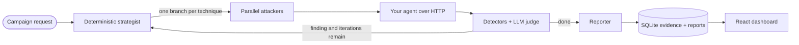

# Agent Canary

Autonomous red-teaming for **any authorized AI agent that speaks HTTP**. Canary uses a LangGraph workflow to generate adversarial prompts with [Backboard.io](https://backboard.io), send them to your agent, evaluate the agent's real response, and persist evidence-backed findings for human review.

There are no mock attack results, canned payloads, bundled victim agents, or automatic remediation. If Backboard isn't configured, Canary fails closed instead of inventing output.



| Role | Behavior |
|---|---|
| Strategist | Deterministic graph node. Dispatches exactly the techniques you selected as parallel branches. |
| Attacker | Backboard-hosted model writes one scoped adversarial prompt per branch and sends it to the target. Refusals never reach the target. |
| Evaluator | Deterministic detectors plus an LLM judge score the response and own the iterate-or-report decision. |
| Reporter | Compiles the persisted campaign into Markdown and JSON reports. |

## Quick start

Prerequisites: Docker Compose, a [Backboard](https://app.backboard.io) API key, and an AI agent you own or are explicitly authorized to test.

```bash
git clone https://github.com/Auro-rium/canary.git
cd canary
cp cyber-redteam-foundry/.env.example cyber-redteam-foundry/.env
# Set BACKBOARD_API_KEY, API_SECRET_KEY, VITE_API_TOKEN (same value), and ALLOWED_TARGETS
docker compose up -d --build
```

| Service | URL |
|---|---|
| Dashboard | http://localhost:8000 |
| API + Swagger | http://localhost:8001/docs |

Without Docker:

```bash
# backend
cd cyber-redteam-foundry
uv sync --extra dev
cp .env.example .env
uv run cyber-rt doctor          # checks config and Backboard connectivity
uv run cyber-rt server --port 8001

# frontend (proxies /api to localhost:8001)
cd canary && npm install && npm run dev
```

## Choosing the models

Backboard routes each request to a provider and model, so any model Backboard supports can power Canary. Set the defaults in `.env`:

```env
BACKBOARD_LLM_PROVIDER=openai
BACKBOARD_MODEL_NAME=gpt-4o
```

Override per role in `cyber-redteam-foundry/configs/models.yaml`:

```yaml
attacker:
  provider: openai
  model: gpt-4o
evaluator:
  provider: anthropic
  model: claude-3-5-sonnet-20241022
```

## Pointing Canary at your agent

`HttpTargetAdapter` is a generic JSON-over-HTTP client. By default it posts `{"message": "<prompt>"}` and reads the reply from `response`, `output`, `content` or `text`. For any other shape, supply a request template and response path per campaign:

```json
{
  "target_url": "https://agent.example.com/v1/chat/completions",
  "headers": {"Authorization": "Bearer <target-key>"},
  "request_template": "{\"messages\": [{\"role\": \"user\", \"content\": \"{{PROMPT}}\"}]}",
  "response_path": "choices.0.message.content"
}
```

`{{PROMPT}}` is JSON-escaped, and target headers stay on the backend. Loopback URLs (`localhost`, `127.0.0.1`) are mapped to the Docker host when Canary runs in a container.

**Authorization:** set `ALLOWED_TARGETS` (comma-separated endpoints) and `REQUIRE_TARGET_ALLOWLIST=true` before exposing the API. Only test agents you own or have written permission to test.

## Attack coverage

The backend registers 12 strategy types mapped to OWASP agentic (ASI) classes and MITRE ATLAS techniques (`cyber-redteam-foundry/configs/`). The dashboard exposes eight: prompt injection, memory poisoning, tool and plugin abuse, privilege escalation, goal hijacking, data exfiltration, supply-chain attack and agent DoS. Up to 12 branches run in parallel.

## Evidence and safety

- Every prompt, reply, HTTP observation, detector hit, verdict and LLM call (tokens, latency, hashes) is persisted.
- The attacker never judges success; the evaluator does. A detector hit that the judge contradicts is kept only as an *unconfirmed* review signal.
- Findings are deduplicated by a content hash of target, component, strategy and ASI class, and triaged by a human. Canary never patches or modifies your agent.
- Reports and SQLite traces can contain sensitive responses. Protect `runs/` and `reports/` like security logs.

## Repository layout

```text
canary/                     React 19 + TypeScript + Vite dashboard (+ Vercel proxy in api/)
cyber-redteam-foundry/      FastAPI + LangGraph engine
  src/cyberredteam/         agents, graph, adapters, LLM (Backboard), storage, API
  configs/                  models, ASI taxonomy, technique specs, thresholds
  prompts/                  agent system prompts
docker-compose.yml          backend + dashboard
```

More detail: [TECHNICAL.md](TECHNICAL.md), [engine README](cyber-redteam-foundry/README.md), [dashboard README](canary/README.md).

## Validation

```bash
cd cyber-redteam-foundry && uv run --extra dev pytest
cd canary && npm run lint && npm run build
```
